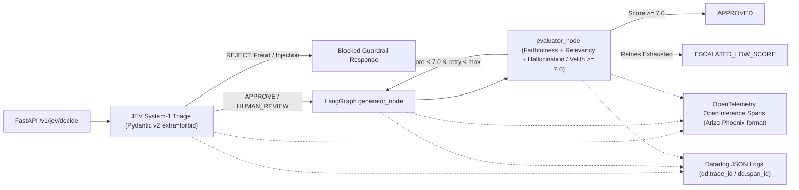

# JEV System-1, LangGraph QA, DeepEval/RAGAS & OpenTelemetry / Datadog / k6 Suite

[](https://github.com/bruno-olivaes/jev-ai-qa-observability-suite/actions/workflows/ci.yml)
[](https://www.python.org/downloads/)
[]()
[]()
[]()

A production-oriented AI Quality Assurance, System-1 classification, stateful agent orchestration, and observability benchmark suite built to test structured AI pipelines from schema safety to load SLAs.

---

## Architecture Overview



---

## Verified Execution Results (Measured Locally)

| Component | Audit Scope | Measured Result | Artifact |
| :--- | :--- | :--- | :--- |
| **Pytest QA Gate Suite** | 10 unit & integration tests | **10/10 PASSED** (`0.70s`) | [tests/](tests/) |
| **JEV System-1 Classifier** | 120 balanced labeled requests (4 classes) | Accuracy **1.0000**, Macro-F1 **1.0000**, ECE **0.0801**, Brier **0.0199**, In-proc P95 **0.0432 ms** | [results/jev_calibration_drift_report.json](results/jev_calibration_drift_report.json) |
| **Drift Detection** | Baseline vs. shifted fraud/dispute mix | Confidence PSI **1.5491** (`CRITICAL_DRIFT`), JS Div **0.2317** | [results/jev_calibration_drift_report.json](results/jev_calibration_drift_report.json) |
| **DeepEval / RAGAS Suite** | 3 golden + 3 adversarial (numeric hallucination, negation contradiction, off-topic) | **3/3** golden approved (Velith `9.04–9.71/10`), **3/3** adversarial rejected (`0.00–3.00/10`) | [results/eval_report.json](results/eval_report.json) |
| **LangGraph Retry Loop** | Flawed initial draft -> critique -> retry | Self-corrected at **attempt 2**, final score **9.33/10** (`APPROVED`); prompt injection blocked at triage | [src/langgraph_workflow.py](src/langgraph_workflow.py) |
| **OpenTelemetry & Datadog** | Full pipeline trace capture | **206** OpenInference/Phoenix spans + **206** Datadog correlated JSON logs | [results/phoenix_otel_traces.json](results/phoenix_otel_traces.json) |
| **Grafana k6 HTTP Load Test** | Up to 20 VUs over 11s (`POST /v1/jev/decide`) | **2,232 requests** (`202.5 req/s`), **0.00% errors**, checks **100.00% (8,928/8,928)**, **P95 = 12.34 ms** (`< 500 ms`), **P99 = 39.26 ms** (`< 800 ms`) | [results/k6_summary.json](results/k6_summary.json) |

---

## Repository Structure

```
jev-ai-qa-observability-suite/
├── .github/workflows/ci.yml              # GitHub Actions pytest + audit pipeline
├── data/golden_eval_cases.json           # Golden & adversarial RAG/QA evaluation cases
├── load_tests/jev_decision_k6.js         # Grafana k6 load test with P95/P99 SLA thresholds
├── monitoring/
│   ├── datadog_monitors.json             # Datadog APM latency, error-spike, and faithfulness alerts
│   └── datadog_log_pipeline.json         # Log correlation (dd.trace_id) & confidence bucketing
├── results/                              # Executed audit artifacts & trace exports
├── src/
│   ├── api.py                            # FastAPI microservice (/v1/health, /v1/jev/decide, /v1/telemetry/metrics)
│   ├── eval_framework.py                 # DeepEval BaseMetric / LLMTestCase + RAGAS-style suite
│   ├── jev_engine.py                     # JEV System-1 typed Pydantic v2 classifier & escalation policy
│   ├── jev_qa_metrics.py                 # ECE, Brier, Confusion Matrix, PSI, JS Divergence, SLA check
│   ├── langgraph_workflow.py             # Stateful LangGraph triage -> generator -> evaluator -> retry graph
│   └── observability_phoenix_datadog.py  # OpenTelemetry OpenInference (Phoenix) + Datadog log exporter
├── tests/                                # 10 pytest test cases
├── run_full_qa_audit.py                  # Generates full JSON/JSONL evaluation & trace reports
└── GUIA_ENTREVISTA_E_CURRICULO.md        # Interview defense notes & technical Q&A guide (PT-BR)
```

---

## Quickstart

```bash
pip install -r requirements.txt
pytest tests/ -v
python run_full_qa_audit.py

# Optional live API + k6 load test:
uvicorn src.api:app --host 127.0.0.1 --port 8765
k6 run --summary-export=results/k6_summary.json load_tests/jev_decision_k6.js
```

## License

MIT License.
